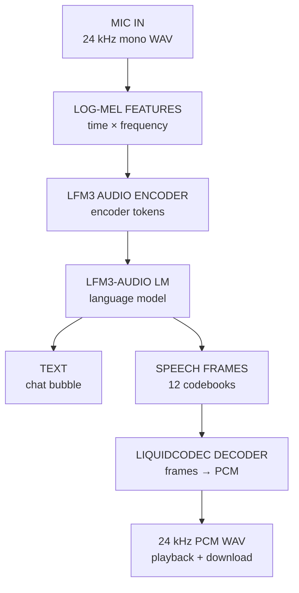

# LiquidCodec Studio — Talk to LFM3-Audio

A local demo of [**LiquidAI/LFM3-Audio-2B**](https://huggingface.co/LiquidAI/LFM3-Audio-2B-MLX-4bit)
(4-bit MLX), Liquid's end-to-end speech model. Speak to it with your voice;
it answers in text and in speech, synthesized from
[**LiquidCodec**](https://huggingface.co/LiquidAI/Liquid-Codec) tokens.

Everything runs locally. No API keys, no uploads.

Requires Python 3.12+, **ffmpeg** on `PATH` (`brew install ffmpeg`), and a
16 GB Apple Silicon machine for the 1.8 GB model.

## Run

```bash
make install
make run
```

Or without make:

```bash
uv sync --extra talk
uv run python app.py
```

Open <http://127.0.0.1:8000>. The 1.8 GB checkpoint downloads from Hugging Face
on first use; the page shows the loading phase, and later visits are instant.

## What it does

- Press **Record**, speak, press **Stop & answer**.
- Pick which input to record from in the **Input** dropdown — the choice
  persists across reloads and survives unplugging (falls back to the system default).
- The page captures mic audio at 24 kHz (mono WAV) and posts it to `/api/talk`.
- LFM3-Audio hears the clip, reasons in text, and answers with interleaved
  text + speech frames. Only the speech frames go through the bundled
  **LiquidCodec** decoder, which produces 24 kHz PCM.
- The reply appears as a chat bubble: answer text, a 120-bar waveform voice
  note with playback, token/timing metadata, and a WAV download.

## Flow



- The **audio encoder** consumes log-mel features, not the raw waveform and not
  LiquidCodec tokens. Its output is projected into the language model.
- The language model emits **text and speech frames interleaved**. The split
  above is logical; it is not two separate model calls.
- **Only the speech frames** go to LiquidCodec. Text goes directly to the chat
  bubble and never passes through the codec.
- LiquidCodec decodes the generated speech frames into a 24 kHz PCM waveform.
  `app.py` wraps that as WAV, returns it as base64, and the browser plays it and
  offers it for download.
- Your mic input never passes through LiquidCodec.

## Check

With the server running:

```bash
make check                 # uses static/sample.wav
make check FILE=question.wav
```

Or directly:

```bash
uv run python talk_check.py
uv run python talk_check.py question.wav
```

It asserts the reply has text and a non-empty 24 kHz WAV and prints the timings.

## How it works

| Piece | Detail |
|---|---|
| Input | Mic → mono float32 at 24 kHz in the browser → 16-bit WAV → `POST /api/talk` |
| Server | ffmpeg decodes to mono float32, rejects clips under 0.3 s or over 30 s |
| Encode audio | Log-mel features → LFM3-Audio audio encoder → encoder tokens → language model |
| Prompt | ChatML: system `Respond with interleaved text and audio.`, one audio placeholder (`apply_chat_template(..., use_tts_template=True)`) |
| Generate | `generate_audio` with `max_tokens=1024` (the checkpoint's voice-chat setting), interleaved text + 12-codebook speech frames |
| Text path | Text tokens are detokenized directly into the chat bubble; they do not enter LiquidCodec |
| Speech path | Speech frames → bundled LiquidCodec decoder → 24 kHz PCM WAV → base64 → browser playback/download |

Measured on the demo machine (M1 Pro, 16 GB, model warm): load 2–3 s, generation
1.5–3.9 s for 65–95 tokens, 3–6 s of reply speech — roughly 2–4 s per turn. A cold
load or the first download is slower. Long answers keep going until the model
stops itself (a 597-token story took 12.4 s to generate, 37 s of speech). Replies
that hit the cap are labelled in the bubble.

## Limits

- Each clip is answered independently; there is no conversation memory.
- 1024 generated slots cap a reply at roughly 30–40 s of speech.
- Answers can be generic or wrong, especially with unclear audio. Demo, not a product.
- The talk path needs Apple Silicon and MLX.

## Files

```
app.py             FastAPI server, model loading, /api/talk, /api/talk/status, /api/talk/load
static/index.html  UI
static/style.css   styles
static/app.js      mic capture, WAV encoding, chat bubbles, waveforms
static/sample.wav  7 s clip used by talk_check.py (synthesized with macOS `say`)
talk_check.py      /api/talk check against a running server
```

## Notes

- Inside LFM3-Audio, your clip goes into the model's audio encoder (log-mel
  features → encoder tokens). LiquidCodec sits on the output side: the model
  generates LiquidCodec speech frames and the bundled decoder turns them into
  24 kHz PCM. This page exercises that in-model output path.
- Model license: [LFM Open License v1.0](https://huggingface.co/LiquidAI/Liquid-Codec/blob/main/LICENSE)
