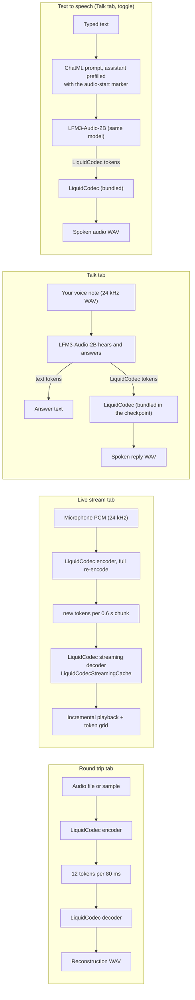
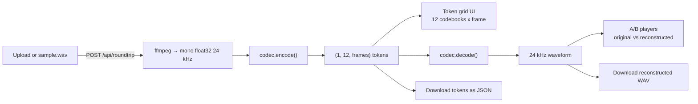
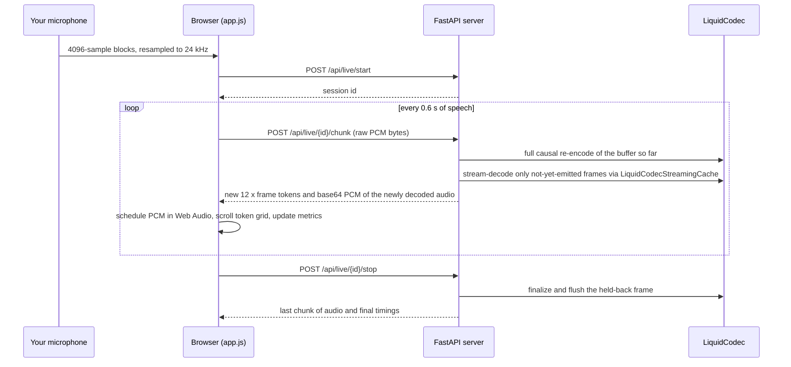
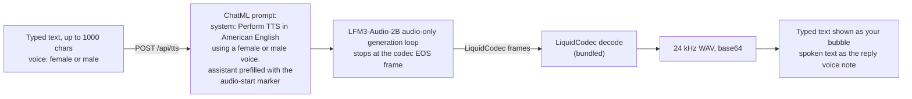
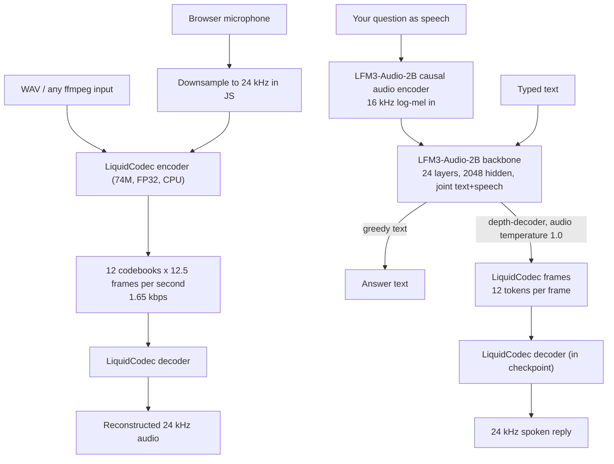

# LiquidCodec Studio

A local demo for [**LiquidAI/Liquid-Codec**](https://huggingface.co/LiquidAI/Liquid-Codec) — a 74M-parameter streaming speech codec that turns audio into 12 tokens every 80 ms (1.65 kbps).

- **Round trip** — drop a file or try the sample, inspect the 12 × frames token grid, A/B the original and the reconstruction, download the WAV or the tokens as JSON.
- **Live stream** — speak into the mic; a live input waveform shows you are being heard, audio is encoded in 0.6 s chunks over plain HTTP and decoded incrementally with `LiquidCodecStreamingCache`, with tokens scrolling as they arrive.
- **Talk to model** — record a question; [LiquidAI/LFM3-Audio-2B](https://huggingface.co/LiquidAI/LFM3-Audio-2B-MLX-4bit) (4-bit MLX) listens, writes an answer, and speaks it back. Its speech tokens are LiquidCodec tokens, decoded by the same codec.
- **Text to speech** — type text in the Talk tab and the same model reads it aloud in American English, with a female or male voice.
- Everything runs locally. No API keys, no uploads.

Requires Python 3.12+ and **ffmpeg** on `PATH` (`brew install ffmpeg`).

## Run

```bash
uv sync --extra talk
uv run python app.py
```

Open <http://127.0.0.1:8000>.

The first start downloads the ~147 MB codec from Hugging Face and caches it. Loading takes a few seconds afterwards.

The **Talk to model** tab also needs Apple Silicon and the 1.8 GB `LiquidAI/LFM3-Audio-2B-MLX-4bit` checkpoint (installed with `mlx-vlm`). The model loads when you first open that tab, and the status strip shows the load phase; later turns take ~1.5–4 s on an M1 Pro and reply with text plus a 24 kHz WAV.

## Check

```bash
uv run smoke.py
```

Loads the model, round-trips `static/sample.wav`, and asserts:

- token shape `(1, 12, ceil(samples / 1920))` and values in range,
- the streaming decoder reproduces the full decode (max diff < 1e-3),
- re-encoding a growing buffer produces the same tokens as a one-shot encode.

For the talk endpoint, with the server running:

```bash
uv run python talk_check.py            # uses static/sample.wav
uv run python talk_check.py question.wav
```

It asserts the reply has text and a non-empty 24 kHz WAV and prints the timings.

## How it works

| Piece | Detail |
|---|---|
| Input | Any format ffmpeg reads → mono float32 at 24 kHz |
| Encode | `codec.encode(wav).audio_codes` → `(1, 12, frames)` |
| Decode | `codec.decode(codes).audio_values` → 24 kHz float32 |
| Live | 0.6 s mic chunks over `POST /api/live/{id}/chunk`, full-buffer causal encode, new frames decoded through `LiquidCodecStreamingCache` |
| Live session | `POST /api/live/start` → chunk → `POST /api/live/{id}/stop` (finalizes the decoder and flushes the held-back frame) |
| Talk load | `GET /api/talk/status` and `POST /api/talk/load` (one-time, shows the loading phase) |
| Talk | `POST /api/talk` with a recorded WAV → LFM3-Audio-2B answers in text and speech (24 kHz WAV, base64) |
| TTS | `POST /api/tts` with `{text, voice}` (up to 1000 chars, `female`/`male`) → LFM3-Audio-2B speaks the text (24 kHz WAV, base64) |
| Limits | 30 s file uploads, 20 s live sessions, 30 s talk clips |

The live encoder re-encodes the whole buffer each chunk because the released encoder has no cache. At roughly 45× real time on this M1 Pro, that keeps up within the 20 s cap. The last frame is held back while streaming so tail padding can't change a token after it has been emitted.

Performance from the demo machine (M1 Pro, FP32 CPU, 7.1 s clip): ~52× real-time encode, ~45× real-time decode.

## Flowcharts

Every tab and lane, end to end. Mermaid renders on GitHub and most editors.

### The demo at a glance



The point of the demo: LiquidCodec is the audio tokenizer and resynthesizer in
every lane. In Round trip and Live it is used directly as a codec; in Talk and
TTS it lives inside LFM3-Audio-2B as its speech output layer.

### 1. Round trip — file in, file out



### 2. Live stream — tokens scroll as you speak



The held-back last frame is what stops tail padding from changing a token that
was already emitted — only finalized frames are ever decoded and played, so you
never hear audio twice or hear a token change shape after it appeared on screen.

### 3. Talk to model — voice in, voice out

```mermaid
flowchart TD
  subgraph LOAD["Load phase, once, when you open the tab"]
    P1["Tab opens: GET /api/talk/status"] --> P2{"model state?"}
    P2 -->|idle| P3["POST /api/talk/load → mlx_vlm.load<br/>LiquidAI/LFM3-Audio-2B-MLX-4bit"]
    P3 --> P4["Status strip: spinner + elapsed seconds"]
    P4 --> P5["Ready: strip turns green,<br/>record button enabled"]
    P2 -->|ready| P5
  end

  subgraph TURN["One chat turn"]
    A["Press record, speak, press Stop"] --> B["Browser encodes a 16-bit mono WAV<br/>(resampled 24 kHz)"]
    B --> C["POST /api/talk (multipart)"]
    C --> D["ffmpeg decode to mono float32<br/>reject clips under 0.3 s or over 30 s"]
    D --> E["ChatML prompt:<br/>system: Respond with interleaved text and audio.<br/>user: one audio placeholder"]
    E --> F["generate_audio (max 1024 slots, greedy text,<br/>audio temperature 1.0, top-k 128)"]
    F --> G1["Text tokens → answer text"]
    F --> G2["LiquidCodec frames → 24 kHz PCM<br/>(decoder bundled with the checkpoint)"]
    G2 --> H["Base64 WAV returned"]
    G1 --> H
    H --> I["Your voice note bubble<br/>(waveform + play)"]
    H --> J["Answer bubble: text + waveform + play/pause,<br/>progress fill, WAV download, token/timing meta"]
    I --> K["Chat history (client-side only)"]
    J --> K
  end
```



### 4. Text to speech — typed text in, voice out



### 5. What carries the tokens where



The released codec has no KV cache, so the live tab re-encodes the whole
buffer every chunk; the decoder, by contrast, stream-decodes through
`LiquidCodecStreamingCache`. Talk and TTS bypass the demo's own codec session
entirely — they speak LiquidCodec tokens out of LFM3-Audio's generation loop.

## Talk to model, end to end

LiquidCodec is a codec, not a language model: it turns speech into 12 codebook
tokens every 80 ms and back, but it cannot decide what to say.
[LFM3-Audio-2B](https://huggingface.co/LiquidAI/LFM3-Audio-2B-MLX-4bit) is
Liquid's end-to-end speech model built on LiquidCodec as its audio tokenizer.
It hears the clip, reasons in text, and generates interleaved text and
LiquidCodec speech tokens; the audio tokenizer bundled with the checkpoint
turns those tokens into 24 kHz PCM. The demo uses the 4-bit MLX conversion
(1.75 GB) so the 2B model fits comfortably on a 16 GB Apple Silicon machine.
A text-only LLM would not work here: it does not share LiquidCodec's token
space.

### 1. Load phase

Opening the tab calls `GET /api/talk/status`. If the model is `idle`, the page
posts `/api/talk/load` and the server runs `mlx_vlm.load` once. The UI shows
the model name, its size, a spinner and elapsed seconds, and keeps the record
button disabled. On success the strip turns green and reports the measured
load time; on failure it shows the error and a Retry button. The model stays
resident, so later tab visits are instant. `POST /api/talk` calls the same
`ensure_talk()` guard, so direct API use works even without the preload step.

### 2. Capture and upload

The record button opens `getUserMedia` and a Web Audio context. A
`ScriptProcessorNode` collects 4096-sample blocks and `resampleTo24k` converts
them to 24 kHz float32; blocks are concatenated when you hit Stop. The browser
packs them into a 16-bit mono WAV with `encodeWav` and posts it as multipart
`file` to `/api/talk`. The page immediately appends your voice note, with a
120-bar waveform computed from those same samples.

### 3. Understand and answer

The server decodes the upload with ffmpeg to mono float32 at 24 kHz, rejects
clips outside 0.3–30 s, and writes a temporary WAV. It builds the prompt the
MLX CLI uses:

- a system message: `Respond with interleaved text and audio.`;
- an otherwise empty user turn carrying one audio placeholder, formatted with
  `apply_chat_template(..., use_tts_template=True)`.

`generate_audio` runs the model's joint text-and-speech loop with
`max_tokens=1024` (the checkpoint's recommended voice-chat setting). The
result contains the answer text, the generated audio tokens and a decoded
24 kHz waveform; the endpoint returns the text, the WAV as base64, token,
finish-reason and generation timings. If the reply still hits the cap, the
page marks the bubble so a truncated ending is not mistaken for a silent one.
The temporary input WAV is deleted immediately after generation.

### 3a. Text to speech

The Talk tab has a "Text to speech" mode that reuses the same model without an
audio input:

- the client POSTs `{text, voice}` to `/api/tts` (1–1000 characters,
  `female` or `male`);
- the server builds the ChatML prompt directly — a system turn
  `Perform TTS in American English using a <voice> voice.`, the typed text as
  the user turn, and an assistant turn prefilled with `<|audio_start|>`, which
  puts the generator straight into audio mode (this is the prefill the model
  card documents for TTS);
- `generate_audio` emits LiquidCodec frames until the codec EOS, and the page
  shows the spoken answer as a voice note exactly like a chat reply. The typed
  text itself appears as a right-aligned bubble, so the transcript is visible.

Text containing `<|` is stripped of that prefix so it cannot inject ChatML
tokens. There is no separate TTS engine; it is LFM3-Audio with a different
system prompt. Voice choice is `female`/`male` American English only — that is
the control the model exposes for speech.

### 4. Reply as a chat bubble

The page turns the WAV into a blob URL and appends the bot bubble: answer
text, a second waveform decoded from the reply WAV, a play/pause control, a
WAV download link, and token/timing metadata. It tries to autoplay the reply;
if the browser blocks that, the play button is right there. Starting one
voice note pauses the other. Both waveforms colour the played portion while
audio runs, and redraw on resize.

### Measured on the demo machine

M1 Pro, 16 GB, model already in the OS disk cache: load 2–3 s, generation
1.5–3.9 s for 65–95 tokens, and 3–6 s of reply speech, so a turn costs roughly
2–4 s once the model is loaded. Long answers keep going until the model stops
itself: a 597-token story took 12.4 s to generate and produced 37 s of speech.
A cold load or the first 1.75 GB download is slower. Peak memory is dominated
by the 4-bit model; the codec itself is FP32 on CPU.

### Limits

- Each clip is answered independently; there is no conversation memory.
- 1024 generated slots cap a reply at roughly 30–40 s of speech. A reply that
  hits the cap is labelled in the chat bubble.
- The model can give generic, wrong or empty answers, especially with unclear
  audio. This is a demo, not a voice assistant to rely on.
- Browser autoplay policies can mute the first reply until you press play.
- The talk tab needs Apple Silicon and MLX; the codec-only tabs still run on
  CPU alone.

## Files

```
app.py             FastAPI server, model loading, /api/roundtrip, /api/live/*, /api/talk*
static/index.html  UI
static/style.css   styles
static/app.js      token grid, waveform, player, mic streaming, push-to-talk chat
static/sample.wav  7 s clip generated locally with macOS `say`
smoke.py           self-check
talk_check.py      /api/talk check against a running server
```

## Notes

- `transformers` 5.22 does not export the codec classes natively, so the app loads the model with `trust_remote_code=True` and fetches `LiquidCodecStreamingCache` from the model repo.
- The bundled sample is synthesized speech, not a human recording. Use the live tab or your own file to judge real voices.
- Model license: [LFM Open License v1.0](https://huggingface.co/LiquidAI/Liquid-Codec/blob/main/LICENSE)